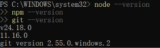
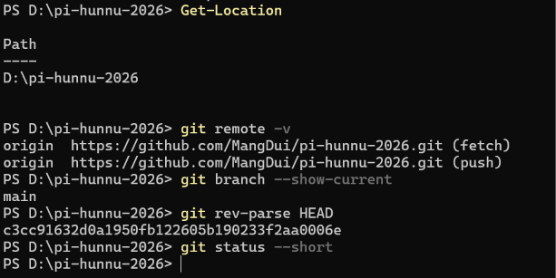
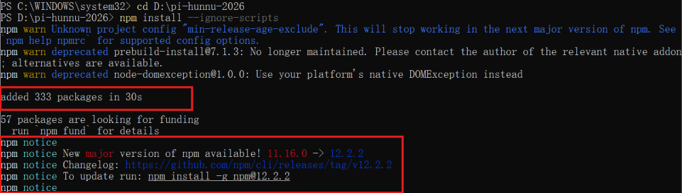
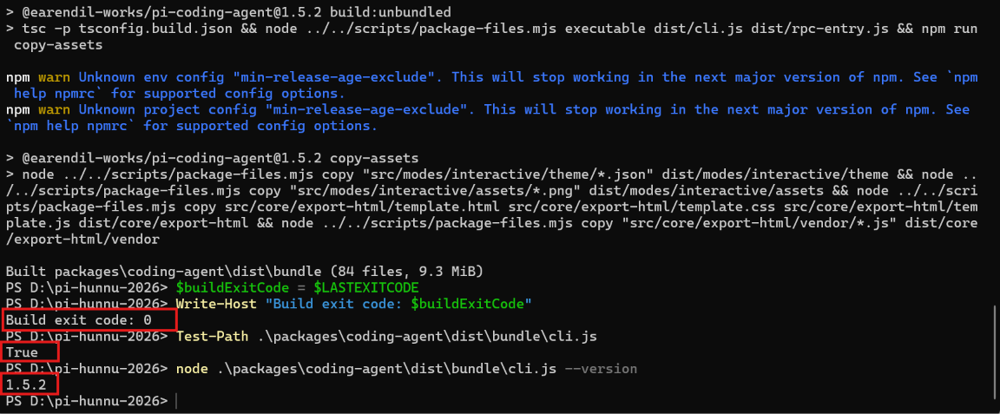
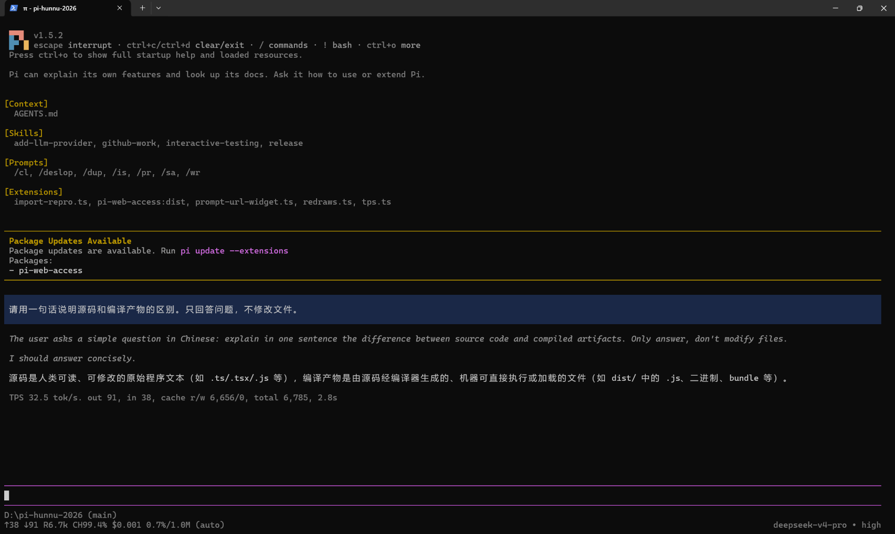
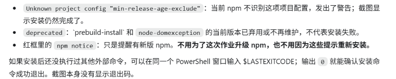
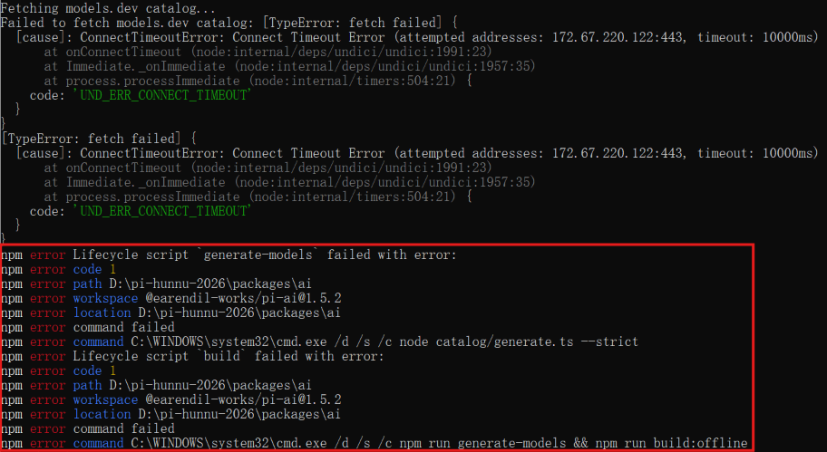
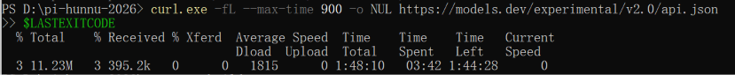
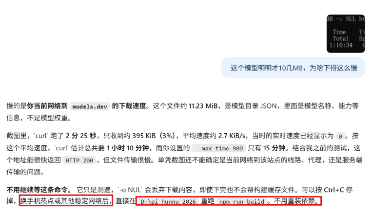

# 实践课 3：Pi Agent 源码安装与编译

- 实践日期：2026-11-17
- 小组源码仓库：[MangDui/pi-hunnu-2026](https://github.com/MangDui/pi-hunnu-2026)
- 实验目录：`D:\pi-hunnu-2026`
- 分支：`main`
- 源码提交：`c3cc91632d0a1950fb122605b190233f2aa0006e`

## 1. 任务一：检查开发环境

在 Windows PowerShell 中使用 `node --version`、`npm --version` 和 `git --version` 检查工具版本。

| 工具 | 实际版本 |
| --- | --- |
| Node.js | `v24.18.0` |
| npm | `11.16.0` |
| Git | `2.55.0.windows.2` |



## 2. 任务二：获取并核对小组源码

进入本地源码仓库后，用 `Get-Location` 检查路径，用 `git remote -v` 核对 `origin`，用 `git branch --show-current` 和 `git rev-parse HEAD` 记录分支和提交。截图中 `git status --short` 没有输出。后面的安装和构建都在源码根目录执行。



## 3. 任务三：阅读项目配置

**Node.js 版本要求在哪里？** 根目录 `package.json` 的 `engines.node` 声明 Node.js 版本为 `>=22.19.0`，本机的 `v24.18.0` 满足该要求。在源码根目录执行下面两条命令，可以直接查看版本要求和构建定义。

```powershell
npm pkg get engines.node
npm pkg get scripts.build
```

**`npm run build` 从哪里读取命令？** 在仓库根目录运行时，npm 从根 `package.json` 的 `scripts.build` 读取命令，再按顺序进入各子包并执行各自的构建脚本。脚本使用 `&&`，上一步失败就会停止。

```text
telemetry → schema → chord → tui → codemode → mcp → ai → durable → env → agent → coding-agent
```

`workspaces` 声明统一管理的包，`package-lock.json` 记录依赖解析结果。CLI 子包在 `packages/coding-agent/package.json` 的 `bin.pi` 中声明入口 `dist/bundle/cli.js`。


## 4. 任务四：安装项目依赖

```powershell
Set-Location D:\pi-hunnu-2026
npm install --ignore-scripts
```

npm 按项目声明和锁文件安装依赖，生成本地 `node_modules` 并关联工作区的包。`--ignore-scripts` 跳过安装阶段自动触发的生命周期脚本，后续仍可主动执行 `npm run build`。

终端显示 `added 333 packages in 30s`。其中 `min-release-age-exclude` 是配置警告，`prebuild-install` 和 `node-domexception` 是弃用提示，最后的 npm 新版本消息是更新通知。安装完成后继续进行了构建。



## 5. 任务五：构建与验证本地 CLI

首次构建需要联网获取模型目录数据。构建完成后立即读取 `$LASTEXITCODE`，再检查 CLI 文件并直接用 Node.js 运行它。

```powershell
npm run build
$buildExitCode = $LASTEXITCODE
Write-Host "Build exit code: $buildExitCode"
Test-Path .\packages\coding-agent\dist\bundle\cli.js
node .\packages\coding-agent\dist\bundle\cli.js --version
```

构建在 `packages\coding-agent\dist\bundle` 下生成了 84 个文件，共 9.3 MiB。根构建退出码为 `0`，入口检查返回 `True`，本地 CLI 输出版本 `1.5.2`。

`$buildExitCode = $LASTEXITCODE` 把刚结束的 `npm run build` 的退出码存入变量。`Write-Host "Build exit code: $buildExitCode"` 把这个值显示在终端，便于在 S5 截图中核对。要在运行 `node` 前保存，因为后续外部命令会更新 `$LASTEXITCODE`。



## 6. 任务六：启动本地源码版并完成会话

**如何确认运行的是本地源码？** 我在 `D:\pi-hunnu-2026` 根目录运行 `.\pi-test.bat`。该脚本调用 `pi-test.ps1`，由 Node.js 加载仓库中的 `packages/coding-agent/src/cli.ts`。源码入口由启动脚本指向仓库内的文件，因此可以根据启动命令和脚本确认运行来源。

**两个入口各适合什么场景？** `.\pi-test.bat` 适合开发时运行和验证当前源码。`dist/bundle/cli.js` 是构建生成的 JavaScript 入口，适合检查打包结果，例如直接运行 `node .\packages\coding-agent\dist\bundle\cli.js --version` 确认产物可用。

交互界面显示版本 `v1.5.2`。我输入“请用一句话说明源码和编译产物的区别。只回答问题，不修改文件。”模型给出了回复，说明源码是可读、可修改的原始程序文本，编译产物是从源码生成、可执行或加载的文件。



## 7. 遇到的问题与排查过程

### 7.1 安装结束时出现 npm 警告

安装输出里同时出现了 `npm warn` 和 `npm notice`，我一开始不确定依赖是否装好，因此我向AI进行了询问，AI帮我区分了配置警告、依赖弃用提示和 npm 版本更新通知，然后我自己详细检查安装末尾后，确认 npm 汇报新增了 333 个包。这些提示没有中断安装，因此我保留现有环境并继续构建。记录见 S4。




### 7.2 下载模型目录超时

第一次执行 `npm run build` 时，构建进入 `packages/ai` 的 `generate-models`，在连接 `models.dev` 时超过 10 秒，报出 `UND_ERR_CONNECT_TIMEOUT`。npm 随后以退出码 `1` 停止构建。



我用 Node.js 请求目录接口，30 秒内未读完整个响应。随后用 `curl.exe` 单独测试下载，约 11.23 MiB 的 JSON 文件在 3 分 42 秒时只传了约 395 KiB，进度为 3%。排查结果表明当时访问目录服务的网络传输很慢，具体是线路还是服务侧导致，未进一步确认。



在AI的指导下，我将网络替换成手机热点后，重新运行构建，成功生成 CLI。


